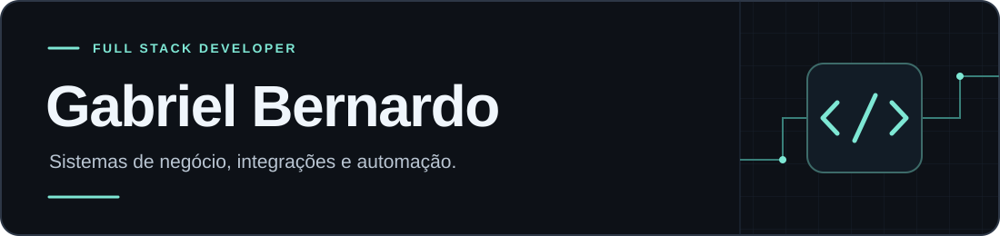

  

  <a href="https://www.linkedin.com/in/gabriel-bernardo-3a59a2228/">LinkedIn</a>
  &nbsp;·&nbsp;
  <a href="#projetos-públicos">Projetos públicos</a>
  &nbsp;·&nbsp;
  <a href="#stack">Stack</a>

## Sobre mim

Sou **Gabriel Bernardo**, desenvolvedor full stack. Construo aplicações web, integrações e automações para processos comerciais e operacionais, conectando interfaces, regras de negócio, dados e serviços externos.

Trabalho principalmente com **TypeScript, React, Next.js, Node.js, Python e PostgreSQL**. Meus projetos incluem sistemas de gestão, ferramentas para o mercado imobiliário, operações de hospedagem, CRM e documentos digitais.

Parte desse trabalho está em repositórios privados. Este perfil reúne minhas frentes de atuação e uma seleção de aplicações, estudos e experimentos com código público.

## O que desenvolvo

| Frente | Aplicações nos meus projetos |
| --- | --- |
| **Sistemas de negócio** | Gestão financeira, painéis internos, propostas comerciais e gestão de equipes. |
| **Integrações e automação** | APIs, webhooks, integração com CRM, distribuição de leads e sincronização de dados. |
| **Produtos web** | CMS, plataformas de conteúdo, portais de indicação e landing pages com formulários de captação. |
| **Dados e documentos** | Coleta e normalização de informações, relatórios, geração de PDFs e integração com assinatura eletrônica. |

Também exploro **IA aplicada** à extração estruturada de informações e a chatbots com busca em documentos, usando recuperação de contexto (*RAG*).

## Stack

| Área | Tecnologias que utilizo |
| --- | --- |
| **Frontend** | TypeScript · JavaScript · React · Next.js · Tailwind CSS |
| **Backend e automação** | Node.js · Python · APIs REST · Webhooks |
| **Dados** | PostgreSQL · Supabase · Prisma · Drizzle · SQLite |
| **Testes** | Vitest · Jest · Playwright |
| **Entrega e ferramentas** | Git · GitHub Actions · Docker · Vercel |

Nos projetos, também trabalho com autenticação, permissões por função, validação no servidor e processamento assíncrono. Em integrações, aplico tratamento de falhas, novas tentativas e controle de duplicidade conforme a necessidade do fluxo.

## Projetos públicos

### Aplicações e estudos de desenvolvimento

| Projeto | O que você encontra |
| --- | --- |
| **[Gerenciador de credenciais](https://github.com/Merle-py/gerenciadorSenhas)** | Projeto de estudo com CRUD, relacionamentos, transações e relatórios. **Java, JPA/Hibernate e PostgreSQL.** |

### Experimentos e fundamentos

- **[Estruturas de dados em Python](https://github.com/Merle-py/trabalho_projeto_arquivos-master)** — Implementações de árvores AVL, B e rubro-negras, com contagem de operações de inserção e remoção.
- **[ChatbotIA](https://github.com/Merle-py/ChatbotIA)** — Protótipo em desenvolvimento para explorar RAG com **Python, Flask, LangChain, Groq e Chroma**.
- **[Shattered Pixel Dungeon Unlocked](https://github.com/Merle-py/shattered-pixel-dungeon-unlocked)** — Fork de [Shattered Pixel Dungeon](https://github.com/00-Evan/shattered-pixel-dungeon), com alterações de desbloqueio de conteúdo e build de APK via GitHub Actions. **Java e Gradle.** Créditos ao projeto original mantidos no repositório.

  
Mais estudos em Python

- [Python-estudos](https://github.com/Merle-py/Python-estudos): exercícios, anotações e automações.
- [Python Crash Course](https://github.com/Merle-py/Python-Crash-Course-2-ed): fundamentos da linguagem e exercícios do livro.

## Contato

Para conversar sobre desenvolvimento de software, integrações ou colaboração, me encontre no **[LinkedIn](https://www.linkedin.com/in/gabriel-bernardo-3a59a2228/)**.
